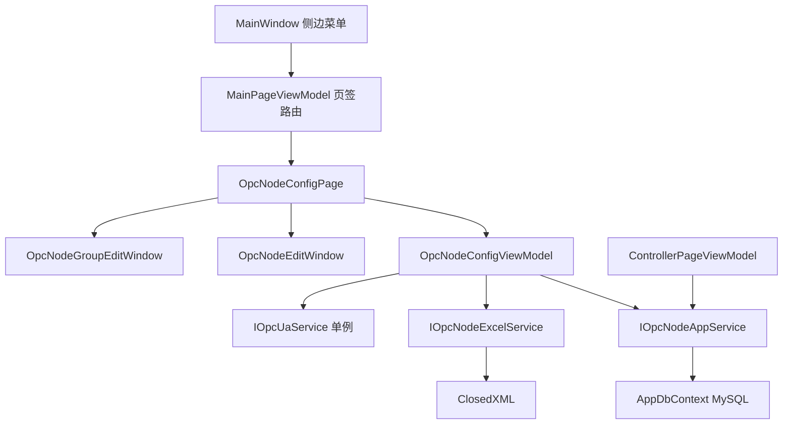

## 产品概述

将现位于“系统设置”页中的 OPC 节点管理能力独立为一个新的【OPC节点配置】页面，形成“分组 + 查询 + 分页表格”的专业配置界面，数据由本地 JSON 迁移到 MySQL 持久化，并支持 Excel 批量维护节点。

## 核心功能

- 左侧导航在“系统设置”下方新增一级菜单项“OPC节点配置”，点击后在主区域新开页签；原“系统设置”页仅保留语言设置与 OPC 连接设置，节点管理卡片整体移除。
- 页面左侧为分组栏：包含“全部节点”“未分组”入口与各分组（带节点数量），支持新建分组、重命名分组、删除分组；点击分组即时过滤右侧节点列表，当前选中项高亮。
- **节点查询**：右侧表格上方提供查询区——关键字输入框（匹配 NodeId 或描述，支持模糊、忽略大小写）、所属分组下拉、可写状态下拉（全部/可写/只读）、实时显示状态下拉（全部/是/否），并配“查询”与“重置”按钮；回车即触发查询，输入过程带 300ms 防抖。查询条件与分页联动：条件变更后自动回到第 1 页；表头下方显示“查询结果共 N 条”与当前生效条件标签（可单条清除）。
- 页面右侧为节点表格：列含 NodeId、描述、所属分组、可写、实时显示、当前值、更新时间；表格下方为分页条（上一页 / 页码 / 下一页 / 每页条数 20/50/100 / 总条数）。
- 通过弹窗创建新节点：填写 NodeId、描述、所属分组、是否可写、是否实时显示；提交前校验 NodeId 非空且全局唯一。
- 通过弹窗编辑节点信息：可修改描述、分组、可写、实时显示；NodeId 作为订阅标识编辑时只读（如需变更走删除后新建）。
- 删除节点前弹出二次确认框，展示待删除节点 NodeId；勾选多行批量删除时在确认框中显示条数。
- 导出 Excel：将**当前查询条件筛选后的结果**导出为 xlsx，列为分组、NodeId、描述、可写、实时显示，文件名默认带时间戳；无结果时提示且不生成文件。
- 导入 Excel：选择文件后解析并校验，弹出预览确认框显示“新增 X 条 / 更新 Y 条 / 跳过 Z 条（原因）”，确认后按 NodeId 合并写入，Excel 中出现的新分组名自动创建；导入完成后刷新分组计数并保持当前查询条件。
- 所有弹窗、按钮、表头文案中英文双语，切换语言后即时刷新。
- 视觉：白色卡片 + 浅灰底，主色蓝，强调选中态与悬停反馈，与现有系统页面风格统一。

## 技术栈

- 桌面端：.NET 8 WPF（net8.0-windows），沿用现有 MVVM 结构
- MVVM：CommunityToolkit.Mvvm 8.4.2（`[ObservableProperty]` / `[RelayCommand]`）
- UI 组件：HandyControl 3.5.1 + 项目共享样式 `Styles/SharedStyles.xaml`
- 持久化：EF Core 8 + Pomelo MySQL（`IDbContextFactory<AppDbContext>`）
- Excel：ClosedXML 0.104.2（项目已引用）
- 日志：Serilog（复用 `ILogger<T>`）
- 实时值：复用单例 `IOpcUaService` 的订阅机制

## 实现方案

### 总体策略

沿用项目既有四层结构：View（Page/Window）→ ViewModel → AppService（DTO 边界）→ EF Core。新增页面与弹窗按命名约定（`*Page` / `*Window` / `*ViewModel` / `*AppService`）自动被 `AddConventionalServices` 注册，无需改 `App.cs`。

### 关键决策

1. **表命名**：现有 `Opc` 表是 PLC 写入记录，不能复用。新增 `OpcNode`（节点）与 `OpcNodeGroup`（分组）两张表。
2. **关系与删除语义**：`OpcNode.GroupId` 可空，空值即“未分组”；删除分组时先把其下节点 `GroupId` 置空（移到未分组），再删除分组，避免数据丢失，与“删除前二次确认”配合。
3. **实时值绑定**：页面直接绑定 `OpcNodeConfig` 实例（这是 `OpcUaService` 按 NodeId 去重后回写的对象）。因此给 `OpcNodeConfig` 增加 `Id`（long）与 `GroupId`（int?）两个普通属性，页面刷新时**复用已有实例、只更新可变字段**，绝不在每次刷新/翻页时新建对象，否则“当前值”列不再更新。
4. **分页与查询**：节点量级为几十到几百，全量一次性读入内存后做客户端查询与分页（`Where` 过滤 + `Skip/Take` 切片），不做数据库 OFFSET 分页，避免翻页抖动与重复查询；查询条件由 ViewModel 持有（`Keyword` / `FilterGroupId` / `FilterWritable` / `FilterRealtime`），统一走 `ApplyFilter()` 重建 `FilteredNodes` 并 `ResetPage()`；关键字比较用 `IndexOf(..., StringComparison.OrdinalIgnoreCase)` 实现中英文不敏感模糊匹配，并 `Trim()` 去空格。
5. **查询与分组栏联动**：点击左侧分组只设置 `FilterGroupId` 并触发查询（与右侧分组下拉双向同步）；点击“全部节点”清空分组条件但保留其它查询条件；点击“重置”清空全部查询条件并把分组选择恢复为“全部节点”。
6. **订阅同步**：新增节点后调用 `SubscribeNodesAsync(new[]{node})`；编辑仅更新描述/分组/标志位；删除只从本地集合移除（不调用 `UnsubscribeAll`，避免打断控制页实时订阅）。连接成功事件仍在此页监听并整体重订阅。
7. **旧数据迁移**：首次加载时若 `OpcNode` 表为空且 `%LocalAppData%/CncWallStation/opc_nodes.json` 存在，则把文件中节点导入“默认分组”，成功后重命名为 `opc_nodes.json.bak`，保证存量配置不丢失。
8. **导入合并**：单事务内按 NodeId 字典化比对，已存在则更新描述/分组/可写/实时显示，不存在则插入；分组名按名查询或新建，全部操作失败回滚。
9. **NodeId 编辑限制**：因 `OpcUaService` 以 NodeId 为订阅键，编辑时锁定 NodeId，避免需要全局重订阅造成控制页实时值中断。

### 性能与可靠性

- 查询/分页/统计均为内存操作，几百条数据无感知延迟；Excel 解析在后台线程执行（`Task.Run`），UI 线程只做结果展示。
- 导入前统一校验：NodeId 为空、长度超 256、同文件内重复均计入“跳过”并附原因，最多展示前 20 条原因。
- 所有数据库操作异常捕获后写 `ILogger` 日志并给出 MessageBox 提示，不吞异常。
- 弹窗关闭时正确释放事件订阅（`StatusChanged`），防止页面多次打开导致订阅泄漏。

## 架构设计



## 目录结构

```
CncWallStation/
├── Models/
│   ├── Entities/
│   │   ├── OpcNodeGroupEntity.cs        # [NEW] 分组实体。Entity<int>，[Table("OpcNodeGroup")]，字段 Id/Name/Description/SortOrder/CreatedAt，protected 无参构造 + 带参构造，Name 唯一约束
│   │   └── OpcNodeEntity.cs             # [NEW] 节点实体。Entity<long>，[Table("OpcNode")]，字段 Id/GroupId/NodeId/Description/IsWritable/IsShowInRealtime/SortOrder/CreatedAt/UpdatedAt；NodeId 唯一索引，GroupId 普通索引
│   └── Dtos/
│       ├── OpcNodeDto.cs                # [NEW] 节点传输对象 Id/GroupId/GroupName/NodeId/Description/IsWritable/IsShowInRealtime；以及分组 DTO OpcNodeGroupDto(Id/Name/Description/NodeCount)
│       └── OpcNodeImportResult.cs       # [NEW] 导入结果：AddedCount/UpdatedCount/SkippedCount/Errors(List<string>)/PreviewRows
├── EntityFrameworkCore/
│   └── AppDbContext.cs                  # [MODIFY] 追加 DbSet<OpcNodeGroupEntity>/DbSet<OpcNodeEntity>，在 OnModelCreating 中配置表名、主键自增、NodeId 唯一索引、GroupId 索引、字段长度、timestamp 默认值
├── Services/
│   ├── Application/
│   │   ├── IOpcNodeAppService.cs        # [NEW] 接口：分组/节点 CRUD、ListNodesAsync(int? groupId, string keyword)、ImportAsync、MigrateLegacyJsonIfEmptyAsync、GetRealtimeNodesAsync
│   │   └── OpcNodeAppService.cs         # [NEW] 实现。注入 IDbContextFactory<AppDbContext> + ILogger；导入用单事务；删除分组前先把节点 GroupId 置空
│   └── OpcUa/
│       ├── IOpcNodeExcelService.cs      # [NEW] 接口：ExportAsync(path, rows)、ReadAsync(path) 返回导入行与校验错误
│       ├── OpcNodeExcelService.cs       # [NEW] ClosedXML 实现：导出带表头与列宽；导入按表头名匹配（分组/NodeId/描述/可写/实时显示），容错布尔写法，跳过空行
│       └── OpcNodeConfig.cs             # [MODIFY] 新增 Id(long) 与 GroupId(int?) 普通属性，供页面与数据库映射；其余属性保持不变
├── ViewModels/
│   ├── OpcNodeConfigViewModel.cs        # [NEW] 核心 VM：Groups/AllNodes/FilteredNodes/CurrentPageNodes 集合、SelectedGroup、Keyword/FilterGroupId/FilterWritable/FilterRealtime、IsFiltering/HasActiveFilter、SearchCommand/ResetSearchCommand、PageIndex/PageSize/TotalCount、节点与分组弹窗命令、Excel 导入导出命令、IOpcUaService 订阅与 Dispose
│   ├── OpcNodeEditViewModel.cs          # [NEW] 节点编辑弹窗 VM：NodeId/Description/GroupId/IsWritable/IsShowInRealtime、IsEditMode、GroupOptions、Validate、保存结果
│   ├── MainPageViewModel.cs             # [MODIFY] _pageMap 增加 { "OpcNodeConfigPage", ("TabHeader_OpcNodeConfig", typeof(Views.OpcNodeConfigPage)) }
│   ├── SettingPageViewModel.cs          # [MODIFY] 移除 OpcNodes/NewNode*/Add/Delete/Clear/LoadNodes/SaveNodes/OnNodePropertyChanged 等节点管理逻辑，保留连接配置与语言切换
│   └── ControllerPageViewModel.cs       # [MODIFY] 删除 JSON 路径常量与 LoadRealtimeNodesFromFile，改为 await IOpcNodeAppService.GetRealtimeNodesAsync() 获取 IsShowInRealtime 节点后订阅
├── Views/
│   ├── OpcNodeConfigPage.xaml(.cs)      # [NEW] 页面：标题栏 + 左侧分组栏 + 右侧查询工具栏/表格/分页条；code-behind 构造注入 VM，Loaded 调用 InitializeAsync
│   ├── OpcNodeEditWindow.xaml(.cs)      # [NEW] 节点新建/编辑弹窗。跟随 ResolveExceptionWindow 风格：520 宽、CenterOwner、灰底白卡、BaseTextBoxStyle、底部取消/保存
│   └── OpcNodeGroupEditWindow.xaml(.cs) # [NEW] 分组新建/重命名弹窗。360 宽，单输入框 + 校验提示
├── MainWindow.xaml                      # [MODIFY] 在“系统设置”菜单项下方新增 SideMenuItem，Header 绑定 Menu_OpcNodeConfig，CommandParameter="OpcNodeConfigPage"
├── Resources/
│   ├── Strings.resx                     # [MODIFY] 新增 Menu_/TabHeader_/PageTitle_OpcNodeConfig 及 OpcNode_*（分组、查询、分页、导入导出、确认框、校验提示）中文键
│   └── Strings.en.resx                  # [MODIFY] 同步新增全部英文键，保证切换英文不出现 #Key#
└── Services/Application/DatabaseInitializerHostedService.cs  # [MODIFY] 追加 CREATE TABLE IF NOT EXISTS OpcNodeGroup / OpcNode 及缺列检查升级语句

documents/sql/06_create_opc_node.sql     # [NEW] 生产环境建表脚本（两张表 + 索引），与 DatabaseInitializer 中的 DDL 保持一致
```

## 关键代码结构

```
// Services/Application/IOpcNodeAppService.cs
public interface IOpcNodeAppService
{
    Task<List<OpcNodeGroupDto>> GetGroupsAsync();
    Task<OpcNodeGroupDto> CreateGroupAsync(string name, string? description);
    Task RenameGroupAsync(int groupId, string name, string? description);
    Task<int> DeleteGroupAsync(int groupId);            // 返回被移至“未分组”的节点数

    Task<List<OpcNodeDto>> GetNodesAsync(int? groupId = null, string? keyword = null);
    Task<List<OpcNodeDto>> GetRealtimeNodesAsync();     // IsShowInRealtime == true
    Task<OpcNodeDto> CreateNodeAsync(OpcNodeDto dto);
    Task UpdateNodeAsync(OpcNodeDto dto);
    Task<int> DeleteNodesAsync(IEnumerable<long> ids);  // 返回实际删除条数
    Task<OpcNodeImportResult> ImportAsync(IReadOnlyList<OpcNodeImportRow> rows);
    Task MigrateLegacyJsonIfEmptyAsync(string legacyJsonPath);
}
```

```
// Services/OpcUa/IOpcNodeExcelService.cs
public interface IOpcNodeExcelService
{
    Task ExportAsync(string filePath, IReadOnlyList<OpcNodeExportRow> rows, string groupAllLabel);
    Task<OpcNodeImportParseResult> ReadAsync(string filePath); // 返回有效行 + 逐行错误信息，供预览弹窗使用
}
```

```
// ViewModels/OpcNodeConfigViewModel.cs —— 查询相关成员
public ObservableCollection<OpcNodeGroupItem> Groups { get; }      // 首项为“全部节点”
public ObservableCollection<OpcNodeConfig> AllNodes { get; }        // 全量缓存（实例复用）
public ObservableCollection<OpcNodeConfig> FilteredNodes { get; }   // 查询结果
public ObservableCollection<OpcNodeConfig> PageNodes { get; }       // 当前页视图

[ObservableProperty] private string _keyword = string.Empty;
[ObservableProperty] private int? _filterGroupId;                    // null = 全部
[ObservableProperty] private OpcNodeWritableFilter _filterWritable;   // All/Writable/ReadOnly
[ObservableProperty] private OpcNodeRealtimeFilter _filterRealtime;   // All/Yes/No
[ObservableProperty] private bool _hasActiveFilter;                   // 控制“重置”按钮可用性
[ObservableProperty] private int _totalCount;

private void ApplyFilter();   // 组合条件过滤 AllNodes → FilteredNodes，重置 PageIndex=1 后 RefreshPage()
private void RefreshPage();   // 按 PageIndex/PageSize 从 FilteredNodes 切片重建 PageNodes
[RelayCommand] private void Search();       // 手动触发查询
[RelayCommand] private void ResetSearch();  // 清空全部条件并回到“全部节点”
```

## 实现要点

- 页面每次 `Loaded` 与页签激活时刷新列表，但必须按 Id 复用已有 `OpcNodeConfig` 实例，仅回填 `Description/IsWritable/IsShowInRealtime/GroupId`，保留 `CurrentValue/LastUpdated/Quality`。
- **查询链路**：`Keyword` / `FilterGroupId` / `FilterWritable` / `FilterRealtime` 任一变化（`OnXxxChanged` 或防抖计时器回调）→ `ApplyFilter()` → `RefreshPage()` → 更新 `TotalCount` / 页码文本 / 空结果提示；查询为空时表格显示“未找到匹配节点”占位行，而不是空白。
- **查询与导出**：导出使用 `FilteredNodes`（当前查询结果）而非全量 `AllNodes`；若 `FilteredNodes.Count == 0` 弹提示“当前查询条件下无数据可导出”。
- **查询与分组删除**：删除当前筛选中的分组后，若 `FilterGroupId` 指向已删分组则自动重置为“全部节点”并重新查询。
- 分组栏使用 `ItemsControl`/`ListBox` 绑定，含“全部节点”“未分组”伪项，选中项以蓝底 + 左侧色条高亮；分组行悬停显示重命名/删除按钮；分组项上的节点数量随查询条件之外的增删改即时刷新。
- 分页条与表格同卡片内，`CanGoPrevious/CanGoNext` 由 `PageIndex` 与 `TotalCount` 计算，每页条数变更后重置到第 1 页；`PageIndex` 越界时自动收敛到最后一页。
- 日志只记录数量与文件名，不落 NodeId 列表全量；导入失败记录行号与原因摘要；查询只记 `HasFilter` 与结果条数，避免日志噪音。
- 影响面控制：不改 `IOpcUaService` 接口；不动壁纸清单/异常报告等无关逻辑；`SettingPage` 只做删除，不做重构。
- 中英文资源必须成对新增，避免 `#{Key}#` 出现在界面。

## 设计风格

延续现有系统页面语汇：`#F5F5F5` 灰底 + 白色圆角卡片 + `#1677FF` 品牌蓝，信息密度偏高但层次清晰，符合工业上位机长时间盯屏的使用场景。整体不用阴影堆叠，靠边框、区块间距与选中态色块区分层级，保持轻量、克制、专业。

## 页面结构（OPC节点配置）

1. **顶部标题栏卡片**：左侧 4px 蓝色竖条 + “OPC节点配置”标题（18px 粗体），右侧放置“新建节点”主按钮（蓝底白字）、悬停变浅蓝的反馈。
2. **主体左栏（宽 240）**：白色卡片，顶部为分组标题与“新建分组”图标按钮；下方列表依次为“全部节点 · 12”、“未分组 · 3”、“分组 A · 9”等行，行高 36，选中行蓝底 `#E6F4FF` + 左侧 3px 蓝条 + 蓝色文字；悬停行背景 `#F5F5F5`，右侧浮出重命名/删除小图标。
3. **主体右栏（自适应）**：上方查询卡片分两行——第一行为关键字搜索框（占位“搜索 NodeId 或描述”，内嵌清空 ×，回车即查询）与“查询”“重置”按钮；第二行为三个筛选下拉（分组 / 可写 / 实时显示）与右侧操作按钮组（“导入 Excel”“导出 Excel”“批量删除”）。有生效条件时，下方显示条件标签行（如“关键字：MCC ×”“分组：A ×”），点击 × 单独清除该条件。下方节点表格卡片，表头浅灰，行高 38，选中行蓝底；列宽按内容分配，NodeId 列等宽字体显示，当前值列对 Good/Bad 用绿/红着色。
4. **表格底部（同卡片内）**：左侧“查询结果 N 条 · 当前 1-20 条”，右侧分页控件“上一页 / 1 2 3 … / 下一页”与每页条数下拉，当前页按钮蓝底白字，禁用态为灰字无边框。

## 弹窗设计

- **新建/编辑节点**：520 宽居中弹窗，标题“新建 OPC 节点 / 编辑 OPC 节点”，四个白卡分区（NodeId、描述、分组下拉、开关区），底部右对齐“取消/保存”；保存失败时在输入框下方显示红色 12px 校验文案，而非弹 MessageBox。
- **分组新建/重命名**：360 宽轻量弹窗，单输入框 + 字数提示（最多 64 字），回车提交。
- **删除确认**：红色主按钮 + 灰底次按钮，标题“确认删除”，正文展示 NodeId 与“此操作不可撤销”。
- **导入预览**：560 宽弹窗，顶部文件路径，中部三色统计条（新增绿、更新蓝、跳过橙），下方可滚动错误清单，底部“取消/确认导入”主按钮。

## 交互与响应

- 所有按钮 150ms 背景过渡，行悬停即高亮，弹窗打开有轻微淡入；语言切换后文案即时刷新，布局不跳动。
- 内容区支持窗口缩放：表格自适应宽度，页面最小 1000×640 不出现横向滚动条；分组栏超高时独立滚动，表格区不随之滚动；查询条件区域在窄宽度下自动换行，不挤压表格。
- 查询反馈即时：输入停顿 300ms 后结果更新，表格不闪烁、不重建选中项，查询结果条数实时显示在底部。

## Agent Extensions

### Skill

- **lsp-code-analysis**
- Purpose: 在移除设置页节点管理逻辑、给 `OpcNodeConfig` 增加 `Id`/`GroupId` 时，做语义级引用查找与影响面核对，确保没有遗漏调用点（`OpcUaService`、`ControllerPageViewModel` 等）。
- Expected outcome: 得到 `OpcNodeConfig`、`SettingPageViewModel.OpcNodes`、`opc_nodes.json` 路径的全部引用清单，并确认修改后无残留引用导致编译或运行期问题。